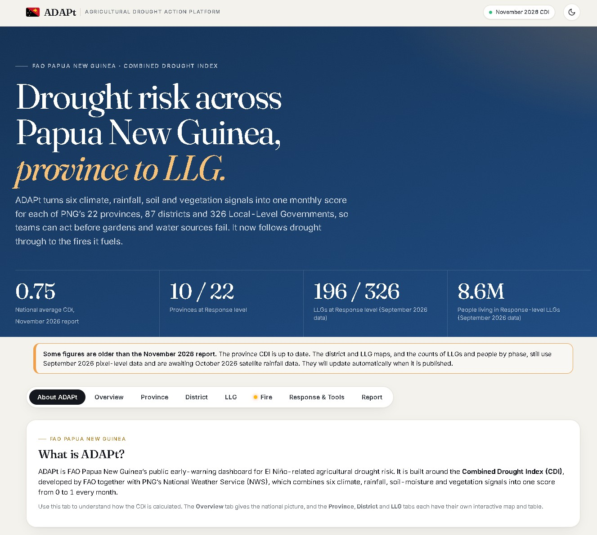
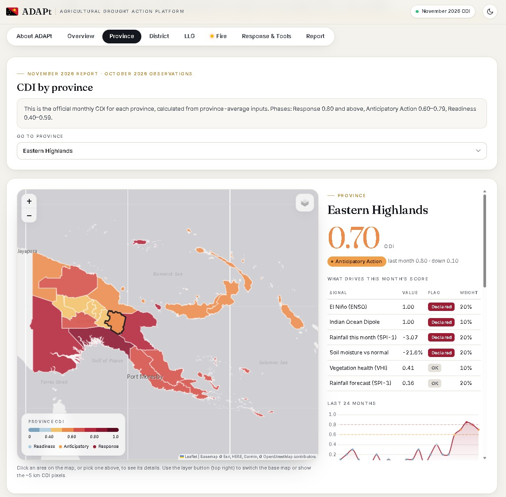
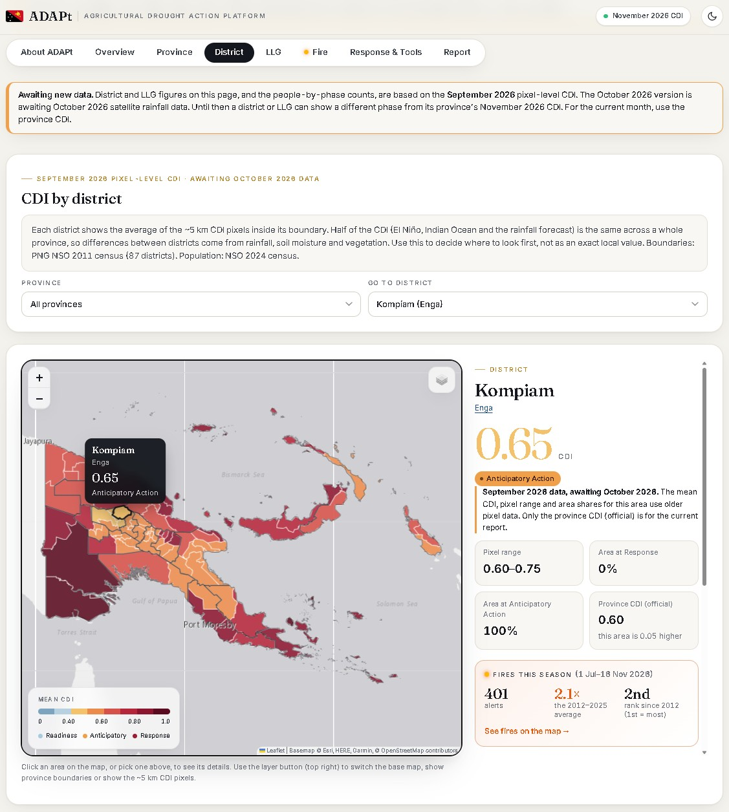
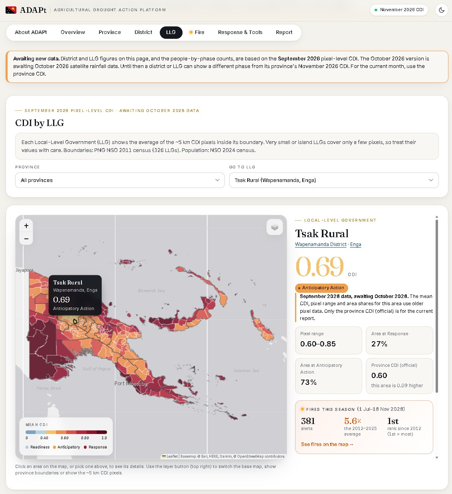
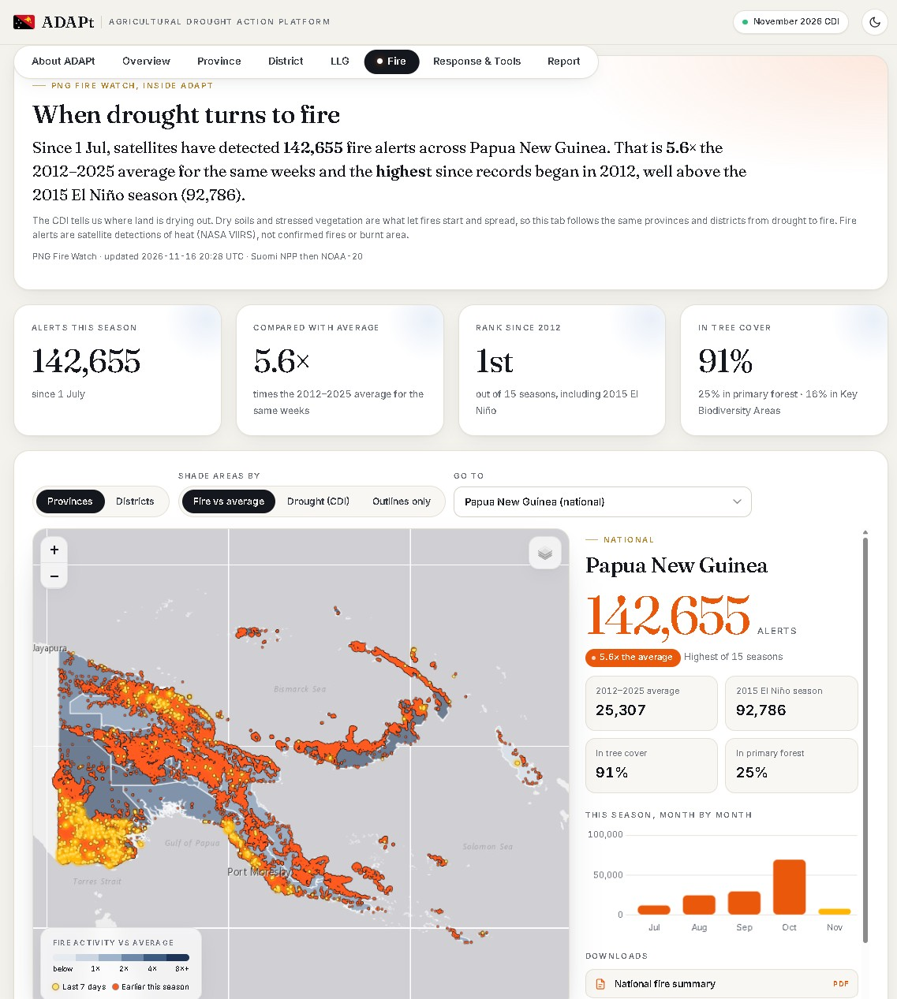
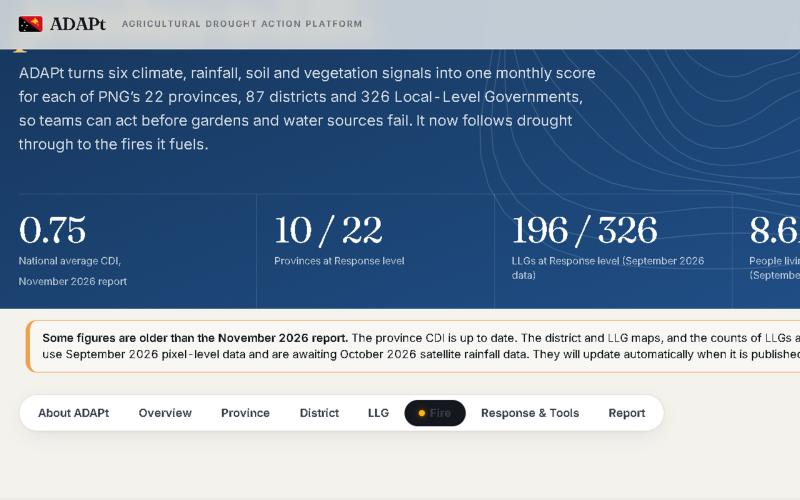

<h1 align="center">ADAPt</h1>
<p align="center"><b>Agricultural Drought Action Platform for Papua New Guinea</b><br>
Combined Drought Index for every province, district and LLG, with drought and fire read together.</p>

<p align="center">
<a href="https://png-elnino.org"></a>
<a href="https://rudoq007.github.io/PNGFireWatch/"></a>
<a href="https://doi.org/10.3390/w16142009"></a>
</p>
<p align="center">


</p>

<p align="center"><a href="https://png-elnino.org"></a></p>

ADAPt is FAO Papua New Guinea's public early-warning dashboard for El Niño-related agricultural drought. It is built around the **Combined Drought Index (CDI)**, developed by FAO with PNG's National Weather Service (NWS) as the government-endorsed trigger for anticipatory action. It shows the CDI for every province, district and Local-Level Government (LLG), with the population living in each phase, and brings in PNG Fire Watch so drought and fire can be read together.

**Quick links:** [Live site](https://png-elnino.org) · [How the numbers are made](#how-the-numbers-are-made) · [Dashboard tabs](#dashboard-tabs) · [Monthly update](#monthly-update) · [The CDI](#the-cdi) · [Automation](#automation) · [Caveats](#caveats) · [Links](#links)

> ADAPt is a **screening and decision-support tool**. Use it to decide where to look first, verify on the ground and plan action. It does not declare disaster status or give final affected-population counts (see the [Disclaimer](#disclaimer)).

## How the numbers are made

There are two CDI layers. They are built differently and can be different ages. This is the most important thing to understand when maintaining the site.

| | Province CDI | District, LLG and map-pixel CDI |
|---|---|---|
| Source | Monthly `PNG_CDI.rds` from the CDI pipeline (Josh Hooker, FAO). This is the official figure. | Rebuilt nightly from the six weighted inputs using Earth Engine (`scripts/build_cdi_pixel.py`) |
| Update | When a new `.rds` is committed | Nightly, once the month's satellite rainfall is available |
| Feeds | Province tab, Overview, hero figures, Province CDI column everywhere | District tab, LLG tab, map raster, LLG and people-by-phase counts |
| Method | Province-average inputs, Gamma-fitted SPI | Per pixel (about 5 km); SPI-1 and soil moisture are empirical approximations (see Caveats) |

**Freshness notice.** The pixel layer needs the observation month's CHIRPS rainfall, which can reach Earth Engine days or weeks after the province CDI is ready. When the pixel layer is older than the report, the site says so: a banner under the header, a note on the District and LLG tabs, notes beside the pixel-based people and district figures, "(September 2026 data)" style labels on the hero stats, and a caveat in the printable report. It works from `data/cdi_pixel_status.json`, which `build_cdi_pixel.py` rewrites only after a successful raster export, and it clears itself once the new month builds.

## Dashboard tabs

<table>
<tr>
<td width="50%"><a href="https://png-elnino.org/#province"></a><br><sub><b>Province</b>: official monthly CDI, with the signals behind each score</sub></td>
<td width="50%"><a href="https://png-elnino.org/#district"></a><br><sub><b>District</b>: 87 districts from the pixel layer</sub></td>
</tr>
<tr>
<td width="50%"><a href="https://png-elnino.org/#llg"></a><br><sub><b>LLG</b>: 326 Local-Level Governments</sub></td>
<td width="50%"><a href="https://png-elnino.org/#fire"></a><br><sub><b>Fire</b>: PNG Fire Watch alerts alongside the CDI</sub></td>
</tr>
</table>

<sub>Screenshots are from the November 2026 report and show the "awaiting October data" notices described below.</sub>

| Tab | What it shows |
|---|---|
| **About** | What ADAPt is, how the CDI is calculated, an interactive national map and province selector, and per-province indicator charts and history back to 1996 |
| **Overview** | National picture: average CDI, provinces ranked by CDI, change since last month, climate drivers (ENSO and IOD), people by CDI phase |
| **Province** | Province CDI map and table, with the indicator flags behind each score, districts and people |
| **District** | District CDI map and table (87 districts), from the pixel layer |
| **LLG** | LLG CDI map and table (326 LLGs), from the pixel layer |
| **Fire** | PNG Fire Watch alerts alongside the CDI (read live from the PNG Fire Watch site), with combined drought-and-fire CSV downloads |
| **Response & Tools** | CDI phase to recommended action, field verification guidance, NWS forecast links and mirrored imagery, linked tools |
| **Report** | Builds a printable CDI briefing in the browser (nothing is uploaded or stored) |

<p align="center"><br><sub>The freshness banner and the "(September 2026 data)" labels on the hero stats</sub></p>

## Monthly update

1. Josh sends the month's files (`PNG_CDI.rds`, the summary CSV and map).
2. Replace **`pipeline/PNG_CDI.rds`** in the repo (web upload or `git push`). Only the `.rds` is needed.
3. `update-cdi-data.yml` runs automatically. It regenerates `data/cdi_example_latest.json` and `data/cdi_archive.json` and commits them. When it finishes, `update-integrated-composite.yml` runs, rebuilds the pixel layer and the district and LLG figures, and commits them.
4. Check the **Actions** tab: both runs should be green. The pixel step is allowed to fail without turning the run red, so also open the **Build CDI pixel** log. If it says CHIRPS has no images for the month yet, the notices on the site will show until Earth Engine catches up. The nightly run at 02:45 UTC retries on its own.
5. Check the site: the header pill and the hero stats show the new month.
6. If a script or style file changed, also bump the `?v=` tag on its link in `index.html`, so visitors' browsers fetch the new file.

**Data timing.** In `PNG_CDI.rds`, `YEAR`/`MONTH` is the *observation* month for ENSO, IOD, rainfall, soil moisture and vegetation; `fcYEAR`/`fcMONTH` is one month later and starts the 3-month rainfall forecast window. A row with `MONTH=10` is therefore published as **November's CDI**. `scripts/update_cdi_data.py` does the labelling, so nobody has to work out the month by hand.

**When Josh's inputs are ready** (his notes): ENSO a day or two into the month, SEAS5 forecast about the 5th, vegetation (ASIS dekad 3) about the 6th, IOD the first Thursday of the month.

## The CDI

Six signals are each flagged 0, 0.5 or 1 and combined as a weighted sum from 0 to 1.

| Signal | Source | Weight | Flag 1 / 0.5 / 0 |
|---|---|---|---|
| El Niño (ENSO) | NOAA Niño 3.4 | 20% | Set as 0 / 0.5 / 1 by the pipeline |
| Indian Ocean Dipole (IOD) | NOAA dipole index | 10% | Set as 0 / 0.5 / 1 by the pipeline |
| Rainfall this month (SPI-1) | CHIRPS | 20% | below -0.5 / below 0 / otherwise |
| Soil moisture vs normal | ERA5-Land | 20% | below -15% / below -5% / otherwise |
| Vegetation health (VHI) | FAO ASIS | 10% | below 0.3 / below 0.4 / otherwise |
| Rainfall forecast (SPI-3) | ECMWF SEAS5.1 | 20% | below -1 / below 0 / otherwise |

**Phases** (from Table 1 of the FAO PNG Food Security and Agriculture Sectoral Plan): **Readiness 0.40–0.59**, **Anticipatory Action 0.60–0.79**, **Response 0.80–1.00**. Below 0.40 is shown as "Monitoring". The logic lives in one function, `cdiOperationalPhase()`, so maps, popups and text cannot disagree.

## Automation

| Workflow | When | What it does |
|---|---|---|
| `update-cdi-data.yml` | A new `pipeline/PNG_CDI.rds` is pushed | Regenerates `cdi_example_latest.json` and `cdi_archive.json` |
| `update-integrated-composite.yml` | After the CDI update, and nightly at 02:45 UTC | Builds the composite stress layer, the pixel CDI raster, population exposure, and the district and LLG figures |
| `update-pngnws-preview-assets.yml` | Every 6 hours | Mirrors the NWS forecast preview images into `assets/pngnws/` |
| `update-live-asis-vhi.yml` | Nightly at 18:00 UTC | Writes `data/asis_vhi_latest.json` (ASIS vegetation by province; the site does not currently display it) |

Earth Engine credentials are a GitHub secret (`EARTHENGINE_SERVICE_ACCOUNT_JSON`). Nothing sensitive is in the repository.

## Repository layout

```
index.html                    the dashboard page
assets/                       adapt.css, cdi-app.js (tabs, maps, notices), fire.js,
                              report-generator.js, theme.js, pngnws/ (mirrored NWS images)
adm1_nso_province.geojson     province boundaries (22 provinces, incl. Hela and Jiwaka)
adm2_nso_district.geojson     district boundaries (87)
adm3_nso_llg.geojson          LLG boundaries (326)
data/                         generated outputs read by the site (see below)
pipeline/                     inputs: PNG_CDI.rds (monthly), census reference data, province polygons
scripts/                      update_cdi_data.py, build_cdi_pixel.py, build_cdi_admin.py,
                              build_cdi_population_exposure.py, build_integrated_composite.py,
                              build_asis_live.py, fetch_pngnws_previews.py
.github/workflows/            the four workflows above
```

Key files in `data/`:

| File | Made by | Used for |
|---|---|---|
| `cdi_example_latest.json` | `update_cdi_data.py` | Province CDI, indicators and labels for the current report |
| `cdi_archive.json` | `update_cdi_data.py` | CDI history 1996 to now (charts, trend) |
| `cdi_pixel_latest.tif` | `build_cdi_pixel.py` | Pixel-level CDI raster (GeoTIFF download) |
| `cdi_pixel_status.json` | `build_cdi_pixel.py` | Month the raster describes; drives the freshness notice |
| `cdi_admin_latest.json`, `cdi_district_latest.csv`, `cdi_llg_latest.csv` | `build_cdi_admin.py` | District and LLG CDI, phase, population |
| `integrated_priority_latest.json` / `.csv` | `build_integrated_composite.py` | Composite stress and province exposure; also holds the map tile URL for the CDI layer |
| `cdi_population_exposure.json` | `build_cdi_population_exposure.py` | People by CDI phase from census-unit points (not read by the site at present) |
| `composite_biophysical_stress.tif` | `build_integrated_composite.py` | Composite stress raster download |

## Caveats

- **Pixel-layer approximations.** Per-pixel SPI-1 is an empirical z-score and soil moisture an empirical percent departure, not the Gamma-fitted values in `PNG_rain_CHIRPS.rds` and `PNG_SM_ERA5.rds`. The build prints per-province means on every run so they can be checked against `PNG_CDI_summary_*.csv`. Districts and LLGs can therefore differ from their province's official CDI.
- **What varies inside a province.** ENSO, IOD and the rainfall forecast (half the weight) are the same across a whole province, so district and LLG differences come from rainfall, soil moisture and vegetation only. A mean of pixel scores is not the official province CDI.
- **Rainfall source.** The pixel layer reads CHIRPS v2 daily rainfall through Earth Engine (`UCSB-CHG/CHIRPS/DAILY`), which lags the month by days to weeks. The Climate Hazards Center says **CHIRPS v2 production ends after December 2026**, so both this layer and the `.rds` pipeline need a plan to move to CHIRPS v3. Keep province and pixel layers on the same version. `build_cdi_pixel.py` stops early with a clear message if the month's CHIRPS or ERA5-Land data are missing or only partly published.
- **ASIS vegetation.** ASIS provides province averages on an older province list that lacks the two provinces created in 2012. The pipeline gives the new province its parent's value.
- **Population figures.** Population by phase uses NSO 2024 census figures. Province-level, LLG-level and district-level counts, and the census-unit-point figure in `cdi_population_exposure.json`, are different bases. Never add, average or compare them as if they were the same measure, and never mix them with any other population estimate (for example the WorldPop-based exposure in `integrated_priority_latest.json`).
- **A province-level population count** that assigns every resident of a Response province to Response overstates people actually exposed.

## Front end

HTML, CSS and vanilla JavaScript, with Leaflet for maps and Chart.js for charts. No build step. Data is fetched as static files at run time.

## Maintainer notes

- A value looks wrong on the public site? Usual causes: a stale browser cache (bump the `?v=` tag in `index.html`, or hard refresh), a generated file not yet refreshed, or Pages still deploying.
- Change a script or style file: bump its `?v=` tag in `index.html` in the same commit.
- Long history of changes is in the git log; this file describes how things work now.

## Links

| | |
|---|---|
| ADAPt dashboard | https://png-elnino.org (mirror: https://rudoq007.github.io/gisnexus/) |
| PNG Fire Watch | https://rudoq007.github.io/PNGFireWatch/ |
| Source repository | https://github.com/rudoq007/gisnexus |
| CDI paper (Water, 2024) | https://doi.org/10.3390/w16142009 |
| FAO in Papua New Guinea | https://www.fao.org/png |
| PNG National Weather Service | https://www.pngnws.gov.pg |
| FAO ASIS (vegetation) | https://www.fao.org/giews/earthobservation |
| CHIRPS rainfall (Climate Hazards Center) | https://www.chc.ucsb.edu/data/chirps |

## Disclaimer

This dashboard is a **screening and decision-support tool**. Results are intended for early warning, planning and prioritisation. Final interpretation should always be supported by field evidence, technical review and decisions by the appropriate PNG government authorities and partner institutions.
